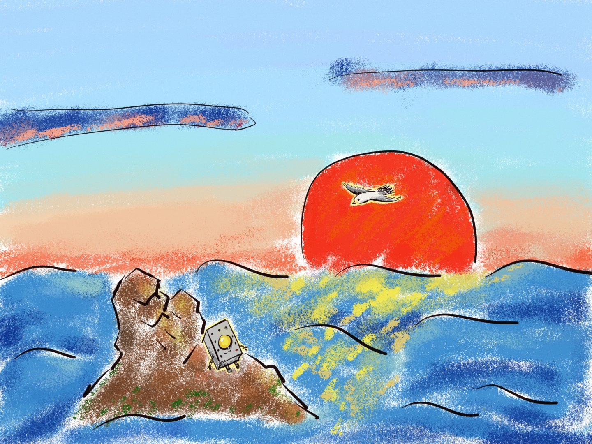

# TAKA Tales — AI Interactive Audio Stories for Children

> [中文](README.md) | **English**

> **In one line**: an interactive narrative product for children aged 3–6. Children advance the story through choices and open-ended dialogue, then receive a personal audio storybook after completing a chapter.

**Try it online**: [takatales.com](https://takatales.com) — runs in phone and tablet browsers, with four chapters available in Chinese and English.

---

## The Story and Its Main Character

TAKA is an old tin robot. With a new source of energy (an LLM), it is trying to find its place in a changed world and hopes to make friends with humans.

It speaks little, often answering with a blinking light. The stories have no standard answers or punishment mechanics. At each decision point, children choose a path or share an idea. TAKA responds to their input as they explore the world together.

> "The sea bottom is full of lights."
> "What's up there? I want to know."
> "Let's go up. Together."



---

## Product Features

- **Interactive picture books with audio**: hand-drawn artwork and character voices, with portrait reading on phones and landscape layouts on tablets.
- **Open-ended interaction**: alongside authored branches, children can express ideas through text or speech. AI characters respond and continue the story.
- **Knowledge cards**: tap glowing keywords about whales, cats, or deep-sea phenomena to unlock illustrated facts and save them in the Memory Bank.
- **Personal storybooks and audio export**: after a chapter, Our Books collects the child's choices and conversations into a storybook, with audiobook export for replay.
- **Parent dashboard and synced progress**: review story paths and conversations, manage multiple child profiles, and resume across devices.

---

## Safety and Engineering Controls

Interactions for children aged 3–6 use the following controls:

- **Output validation**: rules check for violence, obedience-preaching language, gender stereotypes, character behavior violations, and formatting issues. Generated results that fail validation are withheld from players.
- **Three-way input classification**: meaningful input generates a response and advances the story; nonsense holds the scene in place; profanity skips generation and continues along the authored storyline.
- **Bounded generation**: AI fills in an authored plot skeleton. Model calls run server-side, with no API keys in the client, and are audit-logged.
- **Parent controls**: the dashboard provides free-input dialogue logs, including blocked records, and a server-enforced switch for free input.
- **Authentication**: sign-in codes are delivered via SMTP from a branded mailbox and are never echoed in production API responses. SMTP connections verify the server certificate and hostname; delivery failures return an error.

---

## Quick Start

1. **Live product**: visit [takatales.com](https://takatales.com) for Chinese and English stories, landscape picture-book mode, and cloud-saved progress. Guest access is available.
2. **Single-file demo (no installation)**: clone the repository, then open `demo/taka.html` in a browser to try the chapter 1 prototype, *The First Time I Heard the Wind*, including branches, the battery state machine, and achievements.

```bash
git clone https://github.com/AmeliaCai67/TAKA_tales.git
# Then open TAKA_tales/demo/taka.html in your browser.
```

*Note: the `apps/player` player (Vite + TypeScript) requires backend APIs for dynamic generation and speech synthesis. Backend code is private. A static deployment can play authored stories and pre-rendered audio, without AI generation or cloud account features.*

---

## Repository Layout

| Path | Availability | Description |
| --- | --- | --- |
| `apps/player/` | ✅ Open | Player frontend engine (shelf / picture book / dialogue flow / achievements / codex) |
| `packages/story-schema/` | ✅ Open | Content-pack schema and structural validation tools |
| `content/stories/ch01-wind/` | ✅ Open | Complete content pack for chapter 1, *The First Time I Heard the Wind* |
| `demo/` · `index.html` · `hackathon/` · `scripts/` | ✅ Open | Single-file demo, landing page, presentation assets, and release scripts |
| `content/stories/ch02-*` and later | 🔒 Private | Later chapter content packs (core assets) |
| `apps/api/` · `apps/parent/` | 🔒 Private | Backend generation services and parent dashboard |
| `packages/prompts/` · `test/` | 🔒 Private | Prompt library and safety evaluation suite |

---

## Tech Stack

- **Frontend engine**: Vite + TypeScript + vanilla CSS, supporting visual-novel and picture-book layouts.
- **Content format**: `story.json` packs and JSON Schema, with validation of story structure, branch reachability, and audio coverage.
- **Speech synthesis**: Alibaba Cloud CosyVoice (DashScope), combining pre-rendered audio packs and dynamic TTS, with buffering and disk caching.
- **Model roles**: separate models for story generation and offline safety evaluation; model calls and credentials are managed server-side.

## Optional Telemetry

In guest mode, `apps/player/src/anon.ts` uses a random device identifier to report play progress, achievements, and session events to the deployment's `/api/anon/*` endpoints. Data is managed by the deployer, with no third-party tracking; signed-in users use the account data channel. The module can be removed, and failed reports on static deployments do not affect local play.

---

## Roadmap

- [x] Single-file demo prototype (branches / battery / achievements)
- [x] Player engine decoupled from content packs, with schema validation
- [x] First four chapters live in Chinese and English
- [x] Memory Bank and Our Books story export
- [x] 16:9 landscape picture-book mode and transitions
- [x] Voice input v2 (hold to talk, with fallback on unsupported devices)
- [x] Accounts, cloud-synced progress, and parent dashboard
- [x] Dynamic TTS upgrade (CosyVoice with pre-rendered audio and buffering)
- [x] Secure verification emails from a branded mailbox
- [ ] Mobile app packaging and store release
- [ ] More story templates and content creation tools
