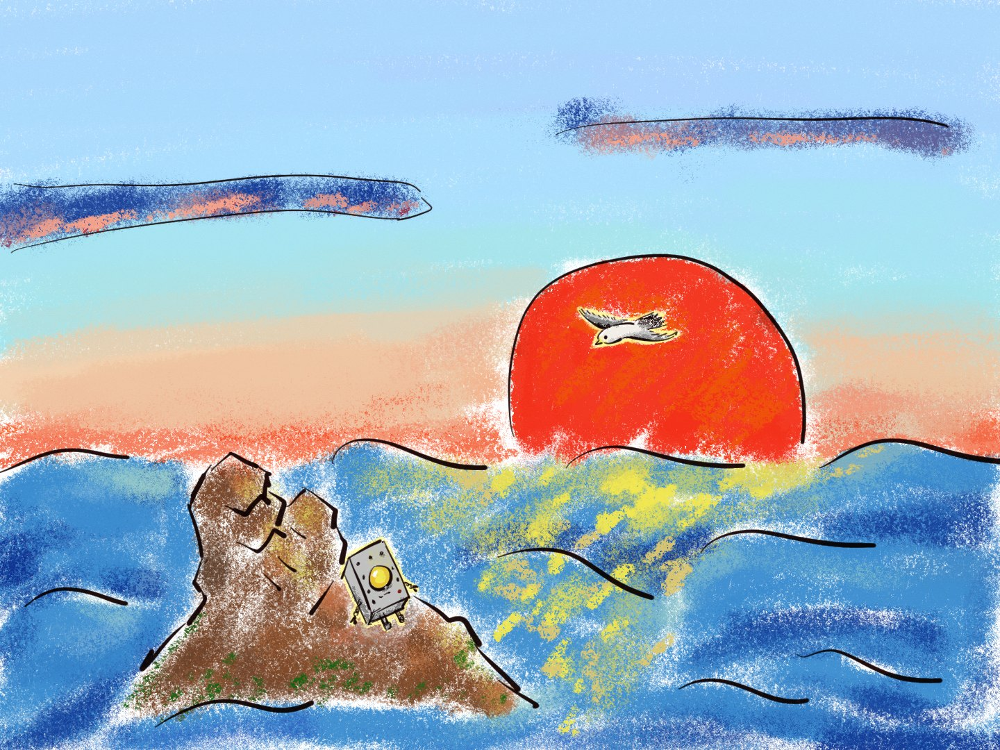

# TAKA Tales — AI-Native Interactive Audio Stories for Kids

> [中文说明](README.md) | **English**

> **In one line**: an interactive narrative product for children aged 3–6 — kids move the story forward with their own choices and words, finish a chapter, and take home an audio story of their very own.
>
> **Our core belief**: we don't build idols; we build mirrors. The AI never decides for the child — it responds to what the child decides.

 

**Live product (4 bilingual chapters, continuously updated)**: [takatales.com](https://takatales.com) — plays directly in mobile/tablet browsers.

---

## What is TAKA?

TAKA is a rusty tin robot about to be scrapped. It got a new battery (an LLM) and is now trying to find its place in a new era. It longs to make friends with humans.

Kids experience stories alongside TAKA, pressing "I want to know" on its behalf at each turning point. There are no correct answers, no punishment, and no princesses waiting to be rescued — all the wisdom, courage and curiosity belong to the child. TAKA is just the mirror: you shine, and it shines.

It speaks little and is often silent, answering with blinks of its light instead.

> "The sea bottom is full of lights."
> "What's up there? I want to know."
> "Let's go up. Together."



*Hand-drawn art: the climax — TAKA surfaces and hears the wind for the first time. The sun has risen.*

## Quick Start

**① Live version**: open [takatales.com](https://takatales.com) — multiple chapters, Chinese/English, landscape picture-book mode, cloud-synced progress. No installation needed.

**② Single-file demo (zero setup)**: open `demo/taka.html` in any browser to play chapter 1, *The First Time I Heard the Wind* — prologue, dream-delay branch, two endings, a battery state machine and achievements. Nothing punishes the child.

```bash
git clone https://github.com/AmeliaCai67/TAKA_tales.git
# then open demo/taka.html in your browser
```

`index.html` at the repo root is a landing page that redirects to the demo.

**Multi-story player (`apps/player`, Vite + TypeScript)**: a story shelf, choice-C free input caught by AI in real time, voice performances. It requires a backend (generation/speech services) which is **not** part of this public repo — deployers bring their own; static-only deployments keep the core gameplay intact (see the telemetry note below).

## Product Form

- **Stories are content packs**: each chapter is a single `story.json` (scenes/branches/battery/achievements/codex/audio manifest), fully decoupled from the engine — `packages/story-schema` ships the JSON Schema and a structural validator (branch closure, scene reachability, audio coverage, zh/en parity). Story-only new chapters ship without touching a line of engine code (chapters 2–3 proved this); a chapter introducing a new interaction type adds a self-contained component in the `mechanics/` component registry, declaratively referenced from story.json — the narrative engine core still stays untouched (chapter 4's collect mechanic proved this).
- **Landscape picture-book mode**: on wide screens/tablets the player enters a 16:9 book stage — hand-painted backgrounds and ambient character performances on the left page, a flowing speech-bubble column on the right; choices materialize as glowing hotspots inside the scene, with three layout modes (book / novel / auto).
- **Kids really change the story**: branching choices at key nodes; free text/voice input at low-stakes nodes, caught by AI and bridged back into the plot (anonymous visitors included, per-device daily quota); graceful fallback on generation failure — the story never breaks.
- **Memory bank (codex)**: story keywords glow warm-yellow once typed out and can be tapped → an entry card (properly licensed real photos + curated science facts + TAKA's take + read-aloud); three-state progressive unlocking, progress isolated per story × child.
- **Our Books**: a journey log collects dialogue as the child plays; finishing a chapter binds it into a book and exports a personal audiobook MP3 — every playthrough becomes a keepable work, not a chat that vanishes.
- **Battery mechanic**: scenes cost battery, the sun charges it back, running out triggers a system-level ending — session length is naturally bounded by the narrative itself; anti-addiction without a kill switch.
- **Voice performances**: pre-rendered mp3s with fixed character voices for scripted scenes, server-side real-time TTS for dynamic text (Alibaba Cloud CosyVoice, same voice source as the pre-rendered assets); a global speed slider; an anti-jitter pipeline (batch warm-up + rolling prefetch + bad-cache self-heal); English lines get word-boundary pronunciation aliases; an audio-priority bus keeps codex narration and story speech from fighting.
- **Multi-child shelf**: cover cards, three-state badges (new / in progress / finished), achievement counts, child switching; notification dots light up on the Books/Achievements/Memory-bank buttons when there's something new.
- **A unified hand-drawn look**: TAKA and every character asset redrawn in a hand-painted metal style; the deep-sea entrance, shelf, reader, collections and settings all share one theming system (light warm-paper / dark night-sea), with the portrait reader and landscape picture-book sharing the same lighting and paper texture.
- **Bubble opening**: TAKA floats out of a bubble on entry, with one-tap resume of your last progress; a startup sound plays and the shelf appears without a flash of the reader.
- **Parent story journal**: the child's listening time, the stories opened, and the words left behind are bound into a flippable journal that can be exported as a shareable long image (by default only cumulative listening and story summaries; the nickname and recent quotes are opt-in per item); bilingual.

## Safety: Engineering, Not Slogans

For an audience of 3–6-year-olds, content safety is a pipeline embedded in the creative process, not a pre-launch manual review:

- **Red-line rule library** (output validator): death/violence/religious vocabulary, obedience-preaching phrases, gender stereotypes and pronouns, character-body continuity ("TAKA has no mouth; no legs underwater"), AI-speaking-for-the-child, format pollution — substring hit = rejection; rules only ever grow;
- **Three-way input triage**: free input is classified first — meaningful input generates and advances, nonsense holds the scene in place, profanity gets zero feedback and no progression;
- **Constrained generation**: the AI only fills in blanks inside the authored plot skeleton; all calls are server-side (zero keys in the client) and fully audit-logged;
- **Parent dashboard**: play records, free-input dialogues (including blocked ones), and a per-child "allow free input" switch enforced server-side.

## Optional Telemetry (Transparency Note)

`apps/player` ships an optional "anonymous visitor analytics" module (`src/anon.ts`): in guest mode it silently reports play progress/achievements/session events to the site's `/api/anon/*` endpoints (device is a random UUID; no personally identifiable information).

- **Static-only deployments** (e.g. GitHub Pages) have no backend; requests 404 silently and nothing breaks;
- **Data belongs to the deployer**; no third-party tracking; remove the module if you don't want it;
- It never affects core gameplay; logged-in users go through the proper account pipeline, not this module.

## Why Not a "Perfect Idol"?

The traditional content industry trains consumers to worship perfect idols, then collapses collectively when the idol shows any human flaw. The next generation of children doesn't need gods — they need to see themselves.

| ❌ You will never see in TAKA | ✅ Instead |
|--------|--------|
| Sacrificing oneself to save others | "Let's figure it out together" |
| Gender stereotypes (princess waiting to be rescued) | All characters are neutral; ability is decoupled from gender |
| "Good kids obey" | "Want to try?" / "You decide." |
| Evil must be destroyed | "Things you don't understand can be avoided — or talked to" |
| "You are special / the chosen one" | "You are here. That's enough." |
| Religious vocabulary | Sci-fi concepts (energy, signals, memory bank) |

## Repository Layout

This repository has two remotes: `origin` (private main repo for day-to-day development, tracking everything) and `public` (open-source repo, containing only the whitelisted paths below). Both repos carry this README, so the exact boundary of "the open part" is **defined by the release mechanism and verifiable inside the repo**:

- The whitelist lives in the `ALLOWED` array of `scripts/release-public.sh`; the `FORBIDDEN` array hard-blocks private paths — a private path mistakenly added to the whitelist aborts the release outright.
- Public releases are path-level syncs onto the `opensource` branch (never a whole-branch merge), so private paths physically cannot reach the public repo.
- Consequently: in the public repo, the "🔒 private" paths below **do not exist**; in the private main repo they exist and are git-tracked — by design of the dual-remote model, not a boundary failure.

| Path | Status | Notes |
|------|--------|-------|
| `apps/player/` | ✅ open | Player engine (shelf / book mode / dialogue flow / achievements / codex / our-books) |
| `packages/story-schema/` | ✅ open | Content-pack schema + structural validator |
| `content/stories/ch01-wind/` | ✅ open | Complete content pack for chapter 1, *The First Time I Heard the Wind* |
| `demo/` · `index.html` · `hackathon/` · `scripts/` | ✅ open | Single-file demo / landing page / pitch deck / release scripts |
| `content/stories/ch02-*` and later | 🔒 private | Later chapters (core content assets) |
| `apps/api/` · `apps/parent/` | 🔒 private | Backend generation control · parent data dashboard |
| `packages/prompts/` · `test/` | 🔒 private | Red-line & prompt library · red-line stress-test suite |
| `docs/` · `experiments/` · `AGENTS.md` | 🔒 private | Internal docs · experiment playground · agent working agreement |

## Tech Stack

| Layer | Choice | Notes |
|------|------|------|
| Frontend | Vite + TypeScript + vanilla CSS | Visual-novel + picture-book dual form, no heavy frameworks |
| Content | story.json packs + JSON Schema | content/engine decoupling; validator guards structural correctness |
| Speech | Server-side Alibaba Cloud CosyVoice (DashScope) | Pre-rendered audio packs + dynamic real-time TTS, disk-cached; batch warm-up & rolling prefetch for jitter resistance |
| AI layer | Multi-model division of labor | Plot-fill generation + heterogeneous safety-review models; server-side only, zero keys in the client |

## Roadmap

- [x] Single-file demo prototype (branches / battery / achievements / dual endings)
- [x] Multi-story player engine: content packs decoupled from the engine + validator
- [x] Four chapters live (Chinese & English content packs)
- [x] Memory bank + Our Books (journey log / audiobook export)
- [x] Landscape picture-book mode (16:9 book stage + hotspot choices + page turns)
- [x] Voice input v2 (hold to talk / slide-up-to-edit; auto-degrades on unsupported devices)
- [x] Live operations (accounts / child profiles / cloud progress / parent dashboard)
- [x] Chapter 4 — Hello, 757 (undersea farm collect + console Q&A + tunnel acts)
- [x] Visual overhaul: hand-drawn metal characters + unified deep-sea entrance / shelf / reader theming and icons
- [x] Dynamic speech upgrade: migrated to Alibaba Cloud CosyVoice + jitter hardening + English word-boundary pronunciation aliases
- [x] Parent story journal (flippable + shareable long image + English)
- [ ] Mobile app store release (in preparation)
- [ ] Content library expansion and more story templates

---

*Status: live at [takatales.com](https://takatales.com) with four bilingual chapters. License TBD.*
*TAKA's battery reads: remaining lifespan, unknown. But today, it wants to hear the wind above.*
